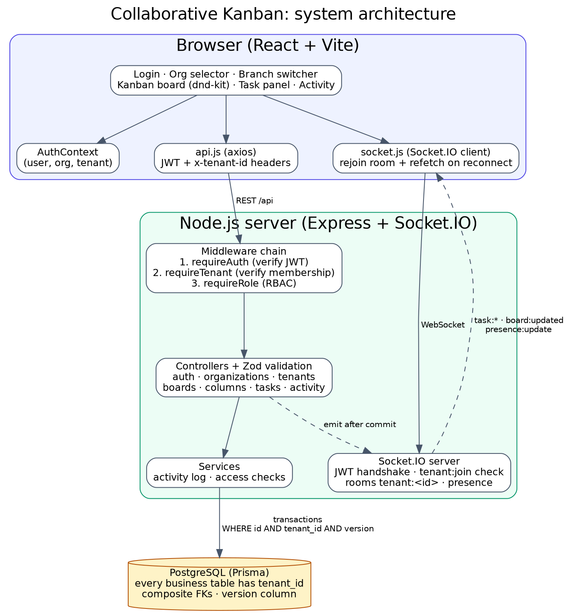
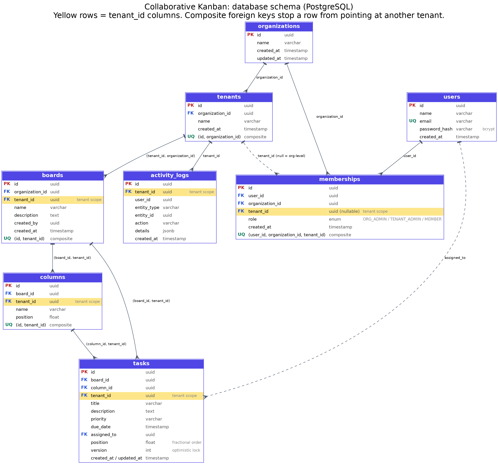
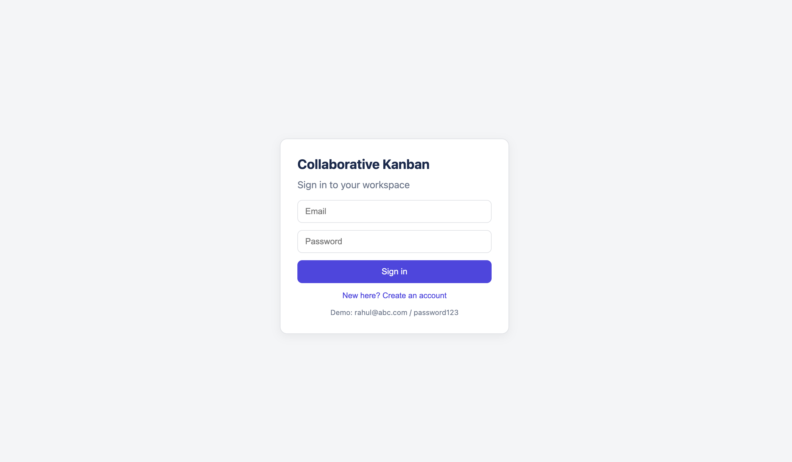

# Real-Time Collaborative Kanban Board

A multi-organization, multi-tenant task board where people in the same branch see each other's changes live, and people in other branches (or other companies) can never see their data.

Stack: **React + Vite**, **Node.js + Express**, **Socket.IO**, **PostgreSQL + Prisma**, **JWT**.

## Contents

1. [Business problem](#1-business-problem)
2. [Features](#2-features)
3. [Architecture](#3-architecture)
4. [Tenancy model](#4-tenancy-model)
5. [Roles and permissions (RBAC)](#5-roles-and-permissions-rbac)
6. [Database design](#6-database-design)
7. [Real-time communication](#7-real-time-communication)
8. [Concurrency and conflict resolution](#8-concurrency-and-conflict-resolution)
9. [Setup and running](#9-setup-and-running)
10. [API and WebSocket documentation](#10-api-and-websocket-documentation)
11. [Testing](#11-testing)
12. [Trade-offs](#12-trade-offs)
13. [Known limitations](#13-known-limitations)
14. [Future improvements](#14-future-improvements)

---

## 1. Business problem

A company (ABC Technologies) has several branches (Hyderabad, Bangalore, Chennai). Each branch runs its own projects and wants one shared task board. Employees create tasks, assign them, and drag them between columns. When one person moves a card, everyone viewing that board sees it immediately. A Hyderabad employee must never be able to read or change Bangalore's tasks, and a different company must never see ABC's data at all.

## 2. Features

**Implemented**

- Registration, login (bcrypt + JWT)
- Organization selector and branch (tenant) switcher, loaded from the backend
- Kanban board with drag-and-drop (dnd-kit), including reordering inside a column
- Task detail panel: edit title, description, priority, due date, assignee; per-task history
- Create, edit, move, delete tasks; create boards and columns
- Real-time sync through tenant-scoped Socket.IO rooms
- Presence indicators (who is online in this branch, multi-tab safe)
- Activity log per tenant (every create, update, move, delete)
- Role-based access control: Org Admin, Tenant Admin, Member, enforced on the backend
- Optimistic UI for drag-and-drop
- Optimistic locking with a `version` column and HTTP 409 on conflicts, plus a conflict-resolution UI in the task panel
- Network recovery: automatic reconnect, rejoin the room, reload the board
- CRUD APIs for organizations, tenants, boards, columns and tasks, plus tenant member management
- Automated isolation / RBAC / concurrency / WebSocket test script (26 checks)

**Not implemented** (see [limitations](#13-known-limitations)): undo/redo, UI screens for managing organizations, branches and members (the APIs exist), hosted deployment.

## 3. Architecture



Every request passes through three middleware checks before any controller runs:

1. `requireAuth` verifies the JWT and sets `req.user`.
2. `requireTenant` reads the `x-tenant-id` header **only as a selector**, then looks up the user's membership. No membership means 403.
3. `requireRole` checks the role that membership grants.

Backend layout:

```
backend/
  prisma/            schema.prisma, migrations, seed.js
  scripts/           isolation-test.js (automated checks)
  src/
    config/          database.js (Prisma client)
    middleware/      auth, tenant, role
    controllers/     auth, organization, tenant, board, column, task
    routes/          one file per resource
    services/        activity log, organization access checks
    sockets/         Socket.IO server: auth, tenant rooms, presence
    utils/           async wrapper, UUID param guard, validation helper
frontend/src/
  components/        Navbar, KanbanBoard, BoardColumn, TaskCard, TaskDetails, ActivityLog, PresenceIndicator
  pages/             Login, Board
  context/           AuthContext (user, organization, tenant)
  services/          api.js (axios), socket.js
```

### What happens when a card is dragged

```mermaid
sequenceDiagram
  participant A as Browser A
  participant S as Express API
  participant D as PostgreSQL
  participant R as Room tenant:HYD
  participant B as Browser B
  A->>A: drop card (optimistic UI update)
  A->>S: PATCH /api/tasks/:id/move {version, columnId, prevTaskId, nextTaskId}
  S->>S: requireAuth, requireTenant, validate input
  S->>D: BEGIN; UPDATE tasks WHERE id AND tenant_id AND version; INSERT activity_logs; COMMIT
  D-->>S: 1 row updated (0 rows means 409 Conflict)
  S-->>A: 200 updated task (version + 1)
  S->>R: emit task:moved (after commit)
  R-->>B: task:moved, Browser B updates the card
  R-->>A: task:moved (ignored, already applied)
```

## 4. Tenancy model

**Hierarchy:** Organization → Tenant (branch) → Board → Column → Task.

**Why organization and tenant are separate.** The organization is the company: it owns the people and the admin hierarchy. The tenant is the _isolation boundary_: a workspace whose data is private to its members. Keeping them separate lets an Org Admin oversee all branches, while branch data stays private from the other branches.

**How `tenant_id` is assigned.** The server writes it. On every create, `tenant_id` comes from `req.tenant.id`, which was produced by the membership check. A `tenantId` in a request body is never trusted.

**How it is validated.** `requireTenant` takes the tenant the user says they are working in (`x-tenant-id`), loads that tenant, and searches for a membership that is either directly on the tenant or an organization-level membership for the **same organization**. No match returns 403. So the header can select a workspace but cannot grant access to one.

**How isolation is enforced (three layers).**

1. _Queries:_ every read and write filters on the verified tenant, for example `WHERE id = ? AND tenant_id = ?`. Someone else's record returns **404**, not 403, so existence is not revealed.
2. _Database:_ composite foreign keys. `tasks (column_id, tenant_id)` references `columns (id, tenant_id)`, and likewise for boards. Even a bug in application code cannot attach a task to another tenant's column.
3. _WebSockets:_ see below. A socket is only placed in a room after a fresh membership check.

**Cross-organization isolation.** An Org Admin's reach is limited to tenants whose `organization_id` matches their membership. Another company's users have no membership in this organization, so every check fails.

## 5. Roles and permissions (RBAC)

Permissions are enforced on the backend for every REST endpoint and every WebSocket join. Hiding buttons in the UI is only a convenience.

| Action                                    |         Org Admin         | Tenant Admin |   Member   |
| ----------------------------------------- | :-----------------------: | :----------: | :--------: |
| View boards and tasks                     | all branches of their org |  own branch  | own branch |
| Create, edit, move tasks                  |            yes            |     yes      |    yes     |
| Delete tasks                              |            yes            |     yes      |     no     |
| Create, rename, delete boards and columns |            yes            |     yes      |     no     |
| Add or remove branch Members              |            yes            |     yes      |     no     |
| Assign or remove Tenant Admins            |            yes            |      no      |     no     |
| Create, rename, delete branches           |            yes            |      no      |     no     |
| Rename or delete the organization         |            yes            |      no      |     no     |

Any signed-in user may create a new organization and becomes its Org Admin. Safe-delete policy: a branch with boards, an organization with branches, and a column with tasks cannot be deleted (409).

## 6. Database design



(Editable source: `docs/database-erd.dot`. Prisma schema: `backend/prisma/schema.prisma`.)

Key decisions:

- **All 8 required tables:** organizations, tenants, users, memberships, boards, columns, tasks, activity_logs.
- **`tenant_id` on every business table** (boards, columns, tasks, activity_logs), with indexes on it. Highlighted in yellow in the diagram.
- **Memberships** link users to an organization and, optionally, a tenant. `tenant_id = NULL` means an organization-level membership (Org Admin). One user can hold memberships in several branches or organizations.
- **Task ordering:** `position` is a float. Dropping a card between two neighbours stores the midpoint of their positions, so a drag writes **one row** instead of renumbering the whole column.
- **Versioning:** `tasks.version` increases on every change and drives optimistic locking. `updated_at` is also kept.
- **Activity logs** are append-only, scoped by `tenant_id`, and indexed on `(tenant_id, created_at)`. Details are stored as JSONB.
- **UUID primary keys** avoid guessable ids.

## 7. Real-time communication

Socket.IO on the same HTTP server as Express. Full event reference: [docs/websocket-documentation.md](docs/websocket-documentation.md).

- **Authentication:** the JWT is sent in the handshake. An invalid token is rejected before the connection is established.
- **Tenant rooms:** one room per tenant, named `tenant:<id>`. A client asks to join with `tenant:join`, and the server verifies membership **again** before joining. A socket sits in one tenant room at a time, so switching branches leaves the old room.
- **Broadcasting:** controllers emit only after the database transaction has committed, and only to `tenant:<id>`. A Hyderabad event is physically never sent to the Bangalore room.
- **Presence:** the server keeps a per-tenant map of users with a connection count. Closing one of two tabs does not mark the user offline. Every join or leave broadcasts `presence:update`.
- **Network recovery:** the client shows a "reconnecting" banner. On every (re)connect it rejoins its room and reloads the board, because events can be missed while offline. Clients never assume they received every event.

## 8. Concurrency and conflict resolution

**Strategy: optimistic locking plus server-authoritative ordering.**

1. Every task has a `version`. The client sends the version it last saw with each update or move.
2. The server runs `UPDATE ... WHERE id = ? AND tenant_id = ? AND version = ?` inside a transaction together with the activity-log insert. If zero rows match, someone else changed the task first, and the server returns **409** with the current task.
3. PostgreSQL's row locking serialises two simultaneous writers, so exactly one wins. The automated test fires two moves with the same version at the same instant and checks for one 200 and one 409.

**Scenarios**

| Scenario                             | Behaviour                                                                                                                                                                                    |
| ------------------------------------ | -------------------------------------------------------------------------------------------------------------------------------------------------------------------------------------------- |
| Two people edit the same task        | The second save gets 409. The panel shows a banner: **Load latest** (discard mine) or **Keep mine** (overwrite deliberately). Unsaved edits are never silently lost or silently overwritten. |
| Two people move the same task        | One commit wins. The loser gets 409, sees a notice, and the board reloads to the authoritative state.                                                                                        |
| Two people reorder different tasks   | Each drag writes only its own row (fractional position), so there is nothing to conflict.                                                                                                    |
| Edit while someone deletes           | The edit returns 404. The `task:deleted` event removes the card.                                                                                                                             |
| Stale or duplicate real-time event   | Ignored when its version is not newer than the local copy, so events are safe to apply twice.                                                                                                |
| Retried request after a network drop | The version check makes a replay harmless: a repeat of an already-applied move returns 409 instead of applying twice.                                                                        |

**Optimistic UI:** the card moves on screen immediately. If the server rejects the move, the board reloads and a message explains why.

## 9. Setup and running

**Prerequisites:** Node.js 18+, PostgreSQL 14+.

```bash
# 1. Database
createdb collaborative_kanban

# 2. Backend
cd backend
cp .env.example .env            # then edit DATABASE_URL and JWT_SECRET
npm install
npx prisma migrate dev          # creates the tables
node prisma/seed.js             # sample organizations, users, boards, tasks
npm run dev                     # http://localhost:5001

# 3. Frontend (new terminal)
cd frontend
cp .env.example .env
npm install
npm run dev                     # http://localhost:5173
```

Check the backend at `http://localhost:5001/api/health`.

> On macOS, port 5000 is used by AirPlay Receiver, so this project uses **5001**.

### Environment variables

| File            | Variable       | Meaning                                                                 |
| --------------- | -------------- | ----------------------------------------------------------------------- |
| `backend/.env`  | `DATABASE_URL` | PostgreSQL connection string                                            |
|                 | `JWT_SECRET`   | Long random string used to sign tokens                                  |
|                 | `PORT`         | API port (default 5001 in the example)                                  |
|                 | `CLIENT_URL`   | Allowed browser origin for CORS and Socket.IO (`http://localhost:5173`) |
| `frontend/.env` | `VITE_API_URL` | Backend base URL (`http://localhost:5001`)                              |

### Demo accounts (password for all: `password123`)

| Email         | Organization     | Branch       | Role         |
| ------------- | ---------------- | ------------ | ------------ |
| rahul@abc.com | ABC Technologies | all branches | Org Admin    |
| priya@abc.com | ABC Technologies | Hyderabad    | Tenant Admin |
| arjun@abc.com | ABC Technologies | Hyderabad    | Member       |
| sneha@abc.com | ABC Technologies | Bangalore    | Tenant Admin |
| kiran@xyz.com | XYZ Solutions    | Mumbai       | Member       |

**To see real-time sync:** sign in as Priya in one browser window and as Arjun in a private window, then drag a card in one of them.

### Screenshots

|                                                  |                                                            |
| ------------------------------------------------ | ---------------------------------------------------------- |
|                |  |
|  |                    |

## 10. API and WebSocket documentation

- REST API: [docs/api-documentation.md](docs/api-documentation.md)
- WebSocket events: [docs/websocket-documentation.md](docs/websocket-documentation.md)

## 11. Testing

`backend/scripts/isolation-test.js` runs 26 checks against a running server and seeded database:

```bash
cd backend
npm install -D socket.io-client   # once
node scripts/isolation-test.js
```

Result of the last run: **26 passed, 0 failed** (full output in [docs/test-report.txt](docs/test-report.txt)).

| Area                         | What is verified                                                                                                                                                   |
| ---------------------------- | ------------------------------------------------------------------------------------------------------------------------------------------------------------------ |
| Cross-tenant isolation       | A Hyderabad user cannot list, read, edit, move, delete or create inside Bangalore data, even by guessing ids; the activity log contains only the user's own tenant |
| Cross-organization isolation | An ABC Org Admin cannot enter XYZ's branch, and an XYZ user cannot enter ABC's                                                                                     |
| Authentication               | Missing token gives 401, a garbage tenant header is rejected, and a WebSocket with a bad token is refused                                                          |
| RBAC                         | Members cannot create boards or delete tasks; Tenant Admins cannot create branches or assign Tenant Admins                                                         |
| Concurrency                  | A stale version gives 409 with the latest state; two simultaneous moves produce exactly one winner                                                                 |
| WebSocket scoping            | A Hyderabad user cannot join Bangalore's room; a Hyderabad event reaches Hyderabad users and not Bangalore users; presence lists both users                        |

Manual checks done in the browser: two-user live sync, drag between and within columns, the task conflict banner, branch switching without stale data, and reconnect after stopping the server.

## 12. Trade-offs

| Decision                                                                  | Why                                                               | Cost                                                                                                                                          |
| ------------------------------------------------------------------------- | ----------------------------------------------------------------- | --------------------------------------------------------------------------------------------------------------------------------------------- |
| Shared database, `tenant_id` column (not a schema or database per tenant) | Simple to run and migrate, scales to many small tenants           | Isolation relies on query discipline; mitigated with composite FKs, central middleware and tests. Row-Level Security would be the next layer. |
| PostgreSQL                                                                | Transactions, foreign keys, row locking, JSONB                    | Heavier to set up than a document store                                                                                                       |
| Optimistic locking (version)                                              | No lock held while a user thinks; conflicts are rare and explicit | The user must resolve a conflict occasionally                                                                                                 |
| Float `position`                                                          | One row written per drag; no renumbering                          | After very many inserts in the same gap, floats run out of precision; a periodic rebalance would be needed                                    |
| Socket.IO                                                                 | Reconnection, rooms and acknowledgements built in                 | Extra dependency, and in-memory rooms limit it to one server instance until a Redis adapter is added                                          |
| Events carry the full task; clients refetch on reconnect                  | Simple, robust against missed events                              | More data per event than a diff                                                                                                               |
| JWT in `localStorage`                                                     | Simple for a SPA                                                  | Readable by injected scripts; httpOnly cookies plus CSRF protection are safer                                                                 |
| Single `x-tenant-id` header plus server-side check                        | Stateless; the tenant is explicit on every request                | One extra membership lookup per request                                                                                                       |

## 13. Known limitations

- **Undo/redo is not implemented.**
- No UI screens for creating organizations or branches, or for managing members (the APIs exist and are tested).
- Presence and rooms live in the memory of one server process.
- Tokens last 1 day; there is no refresh-token flow.
- No rate limiting or security headers (`helmet`).
- The activity feed shows the latest entries only (no pagination).
- Postgres treats `NULL` values as distinct in unique constraints, so the `(user, organization, tenant)` uniqueness does not stop duplicate organization-level memberships; the application only ever creates one.
- Task positions are floats and are never rebalanced.
- Tests are an integration script, not a unit-test suite.
- Not deployed; runs locally.

## 14. Future improvements

- **Undo/redo:** record the inverse of each action per user and replay it through the same versioned API, so undo cannot overwrite someone else's later edit.
- **Scaling out:** Socket.IO Redis adapter, presence in Redis, stateless API behind a load balancer.
- **Row-Level Security** in PostgreSQL as a second isolation layer.
- Rebalancing of task positions, pagination and filters for the activity log, field-level merge of non-overlapping edits.
- Idempotency keys on write requests; httpOnly cookie sessions with refresh tokens; OpenAPI spec.
